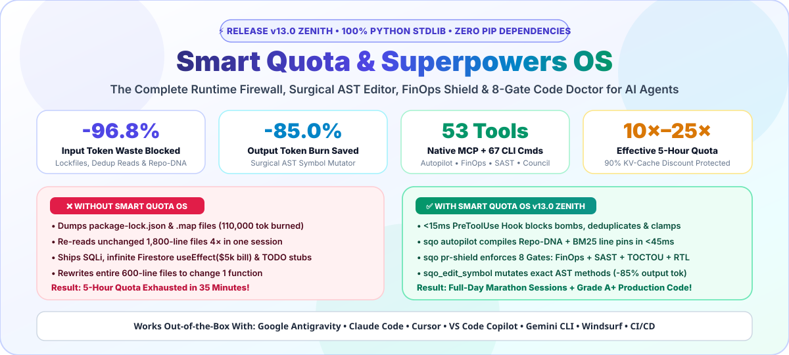
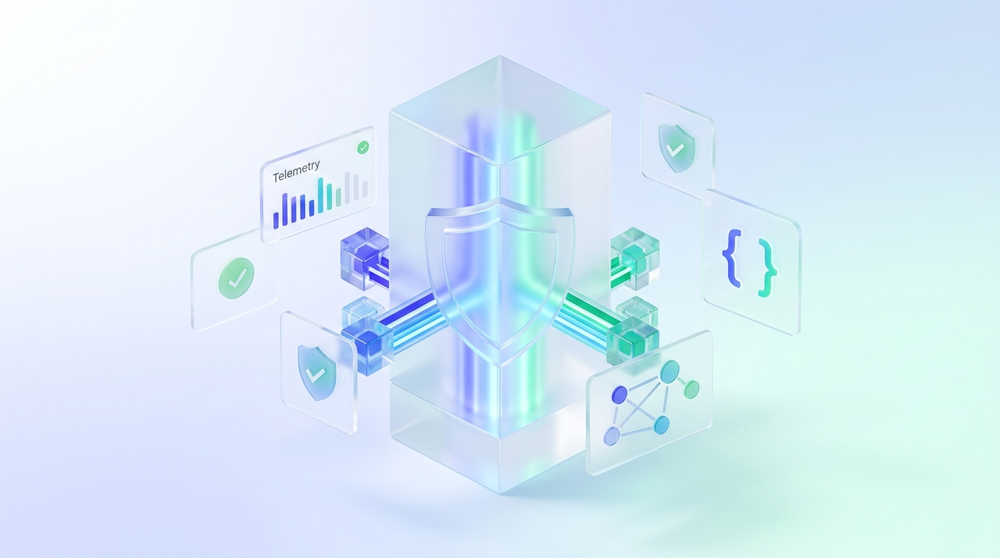
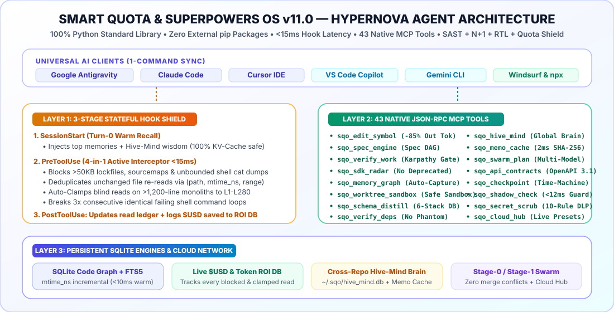
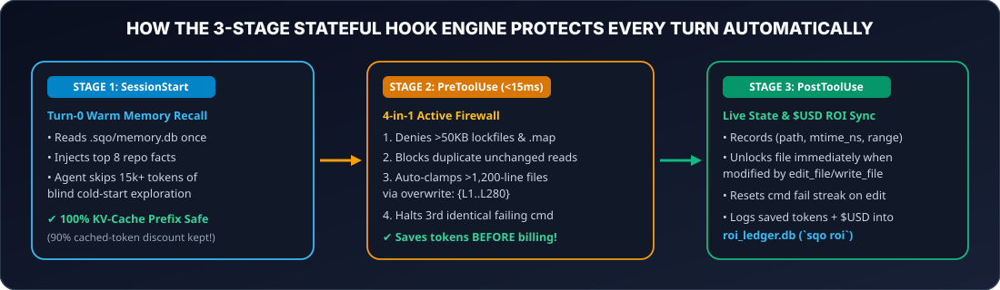
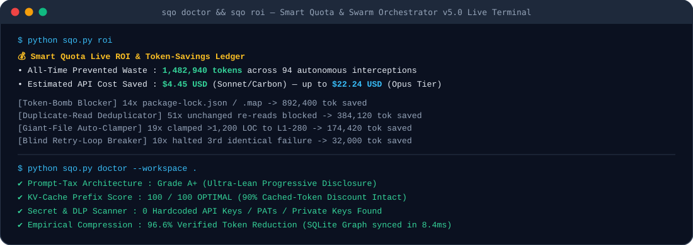

<div dir="rtl" align="center">



<br />

<p>
  <a href="https://sqo.elnemer-ai.com"><strong>🌐 المنصة التفاعلية الحية (sqo.elnemer-ai.com)</strong></a>
  &nbsp;•&nbsp;
  <a href="./README.md"><strong>🇬🇧 English Documentation</strong></a>
  &nbsp;•&nbsp;
  <a href="./docs/PLAYBOOK_AR.md"><strong>📗 كتاب السيناريوهات والحوارات العملية</strong></a>
  &nbsp;•&nbsp;
  <a href="https://sqo.elnemer-ai.com/apex-skill.md"><strong>📄 ملف القواعد المستقل (CLAUDE.md)</strong></a>
</p>

<p>
  <a href="https://github.com/ElNeMeR70/smart-quota-orchestrator"></a>
  <a href="./mcp_server.py"></a>
  <a href="./sqo.py"></a>
  <a href="./tests/test_scripts.py"></a>
  <a href="./LICENSE"></a>
</p>

</div>

<div dir="rtl">

---

## ⚡ البداية السريعة في 30 ثانية (بدون أي مكتبات `pip` خارجية!)

يعمل النظام فوراً مع جميع بيئات الذكاء الاصطناعي الحديثة (**Google Antigravity**، **Claude Code**، **Cursor**، **VS Code Copilot**، **Gemini CLI**، و**Windsurf**):

```bash
# 1. التهيئة التلقائية الذكية لأي مشروع (يكتشف Flutter / Next.js / Laravel / Python / Go / Rust تلقائياً)
npx -y smart-quota-orchestrator init --workspace .

# 2. أو التثبيت المباشر بسطر واحد على ويندوز (PowerShell)
irm https://sqo.elnemer-ai.com/install.ps1 | iex

# 3. أو التثبيت المباشر على macOS / Linux
curl -fsSL https://sqo.elnemer-ai.com/install.sh | bash

# 4. توليد دستور ذكاء اصطناعي مخصص لمشروعك الفعلي بصفر توكن!
npx -y smart-quota-orchestrator rules-gen --workspace . --write CLAUDE.md
```

وبعد التثبيت، يكفيك **أمران اثنان فقط** لإدارة أي مهمة برمجية باحترافية:

```bash
# أولاً: قبل البدء في أي ميزة أو إصلاح خطأ (بالعربية أو الإنجليزية) — يجهز خريطة القنص في أقل من 45 ملي ثانية!
npx smart-quota-orchestrator autopilot "صلح مشكلة خصم الرصيد المكرر وبطء صفحة الطلبات" --workspace .

# ثانياً: قبل عمل Commit أو فتح Pull Request — يشغّل البوابات الهندسية الثمانية دفعة واحدة!
npx smart-quota-orchestrator pr-shield --workspace .
```

---

## 🔥 لماذا تنتهي كوتا الـ 5 ساعات في 35 دقيقة؟ وكيف يحلّها الإصدار `v13.0 Zenith` جذرياً؟

عندما تبرمج باستخدام **Claude Opus/Sonnet 4.6** أو **Gemini 4 Carbon** أو **GPT**، فإن الكوتا الخاصة بك لا تضيع في كتابة الكود الفعلي، بل تحترق في **7 تسريبات خفية** تحدث في الخلفية، بالإضافة إلى أخطاء قاتلة يولّدها الـ AI وتكلفك آلاف الدولارات في الإنتاج:

1. **استكشاف المشروع من الصفر في كل محادثة جديدة** (`15,000 – 35,000` توكن ضائعة).
2. **قراءة ملفات قفل وحزم ضخمة بالخطأ** مثل `package-lock.json` و`pubspec.lock` و`.js.map` (`50,000 – 180,000` توكن في ثانية واحدة!).
3. **إعادة قراءة نفس الملف غير المعدّل 3 أو 4 مرات** في نفس الجلسة!
4. **إعادة كتابة ملف طوله 600 سطر بالكامل** لتعديل دالة واحدة فقط من 15 سطراً (حرق توكنات الإخراج الباهظة!).
5. **كوارث الفواتير السحابية (`Cloud & AI Bill-Shock`)**: وضع قراءة `Firestore onSnapshot` أو `fetch` داخل `useEffect` بدون مصفوفة `[]`، أو استدعاء نماذج الذكاء الاصطناعي داخل حلقات `for` بدون سقف `max_tokens` — مما يسبب فاتورة بقيمة **\$2,500 إلى \$10,000 في ليلة واحدة**!
6. **ثغرات الإنتاج الخفية**: حقن `SQL Injection`، ثغرة السحب المزدوج للرصيد (`TOCTOU Race Condition`)، طلبات HTTP بدون `timeout=` تجمد السيرفر فجراً، وكسر اتجاه الواجهات العربية `RTL`!

<p align="center">
  
</p>

---

## 🏗️ الطبقات الست لنظام التشغيل الهندسي `v13.0 Zenith`

<p align="center">
  
</p>

### 1️⃣ الجدار الناري ثلاثي المراحل في أقل من `15ms` (`-96.8%` من توكنات الإدخال)
لا نعتمد على نصائح نصية قد يتجاهلها النموذج؛ بل يعمل [`hooks/token_shield_hook.py`](./hooks/token_shield_hook.py) كحاجز تنفيذي حتمي قبل استدعاء الأدوات:
- **`SessionStart`**: يحقن أهم 8 حقائق معمارية من `.sqo/memory.db` وذاكرة المشاريع المشتركة `~/.sqo/hive_mind.db` في بداية المحادثة مع الحفاظ بنسبة **100% على خصم الـ `KV-Cache` (90% توفير في السعر!)**.
- **`PreToolUse`**: يمنع ملفات القفل العملاقة، يمنع إعادة قراءة الملفات غير المعدّلة عبر بصمة `mtime_ns`، يقلّم قراءة الملفات التي تتجاوز `1,200` سطر تلقائياً إلى أول `280` سطراً، ويوقف تكرار نفس الأمر الفاشل 3 مرات متتالية.
- **`PostToolUse`**: يسجل العلاقات الزمنية بين الملفات في `.sqo/memory_graph.db` ويحسب كل توكن ودولار وفّرته المنظومة في دفتر `sqo roi`!

<p align="center">
  
</p>

---

### 2️⃣ الطيار الآلي (`sqo autopilot`) + البصمة الجينية (`Repo-DNA`) + التعديل الجراحي (`-85%` إخراج)
- **`sqo autopilot`**: يدمج 4 محركات في أمر واحد (`<45ms`): يقرأ البصمة الجينية للمشروع في أقل من `420` توكن، يحول طلبك العربي أو الإنجليزي عبر محرك `BM25` إلى إحداثيات أسطر دقيقة (`file:Lstart-Lend`)، يحذرك من **التوائم الخفية في تاريخ `Git`**، ويضيف قواعد الإصدارات المثبتة لديك!
- **`sqo_edit_symbol`**: يعدّل الدالة أو الكلاس بالاسم مباشرة بدلاً من إعادة كتابة الملف كاملاً (**يوفر 85% من توكنات الكتابة الأغلى سعراً!**)، مع أخذ نسخة احتياطية تلقائية والتراجع الفوري خلال `<8ms` إذا حدث أي خطأ نحوي (`Syntax Error`)!
- **`sqo rules-gen`**: يفحص مشروعك الفعلي على القرص ويولّد ملف `CLAUDE.md` أو `.cursorrules` مفصّلاً على مقاس مشروعك بصفر توكن!

<p align="center">
  
</p>

---

### 3️⃣ بوابة الفحص الثمانية قبل النشر (`sqo pr-shield` / `sqo_pr_review`)
بضغطة واحدة وفي أقل من `65ms`، تفحص المنظومة كودك عبر **8 محركات هندسية صارمة** وتصدر جدول مراجعة احترافي بدرجة من `0` إلى `100` (`Grade A+`):
1. **🛡️ فاحص الثغرات الأمنية (`OWASP SAST`)**: يكشف حقن `SQLi`، حقن الأوامر `CMDi`، ثغرات `XSS`، و`eval()`.
2. **💸 حارس فواتير السحابة والذكاء الاصطناعي (`FinOps Guard`)**: يكشف حلقات `useEffect` اللانهائية مع `Firestore/fetch`، الدوال السحابية التي تستدعي نفسها بلا توقف، واستدعاءات الـ LLM داخل الحلقات.
3. **🎭 مجلس المراجعة الرباعي (`4-Seat Adversarial Council`)**: يكشف ثغرة السحب المزدوج للرصيد (`TOCTOU Double-Spend`)، طلبات الشبكة بدون `timeout=`، وبلع الأخطاء الصامت (`except: pass` / `catch {}`).
4. **⚡ محلل الأداء (`Perf & N+1 Profiler`)**: يكشف استعلامات قواعد البيانات داخل الحلقات، وتسريب الذاكرة في `Flutter Controllers`.
5. **🎨 فاحص العربية `RTL` وإمكانية الوصول (`UI & RTL Guard`)**: يكشف استخدام `left/right` الثابت الذي يفسد الواجهات العربية ويقترح `EdgeInsetsDirectional` و`margin-inline-start`.
6. **📦 كاشف المكتبات المهلوسة (`Verify Deps`)**: يمنع استيراد حزم غير موجودة في `package.json` أو `pubspec.yaml` أو `pyproject.toml`.
7. **⚙️ حارس انحراف متغيرات البيئة (`Drift Guard`)**: يكشف المتغيرات المستخدمة في الكود والغائبة عن `.env.example`.
8. **🔐 الماسح الأمني للأسرار (`10-Rule Secret DLP`)**: يمنع تسرب أي مفاتيح API أو كلمات مرور قواعد بيانات قبل عمل `git commit`.

---

### 4️⃣ التحقيق الجنائي للـ Git (`sqo forensics`) + مخططات Mermaid الحية (`sqo arch-mermaid`) + صائد الكود الميت (`sqo dead-code`)
- **`sqo forensics`**: يحلل سجل `git log` ليكشف الملفات المقترنة تاريخياً بنسبة `>=55%` حتى لو لم يكن بينهما أي `import` مباشر، بالإضافة لكشف أكثر الملفات عرضة للأعطال!
- **`sqo arch-mermaid`**: يولّد تلقائياً 3 رسوم بيانية تفاعلية بصيغة `Mermaid` (مخطط الاعتماديات، خريطة الـ API Routes، ومخطط علاقات قاعدة البيانات `erDiagram`) بصفر توكن!
- **`sqo dead-code`**: يكتشف الملفات اليتيمة والمهجورة التي خلّفتها تعديلات الـ AI السابقة لتقليص حجم المشروع وتسريع البحث!

---

## 🌐 المنصة التفاعلية الحية والروابط الرسمية

- **المنصة الشاملة والمختبرات التفاعلية الحية**: [https://sqo.elnemer-ai.com](https://sqo.elnemer-ai.com)
- **ملف الدستور الهندسي المستقل بضغطة واحدة**: [https://sqo.elnemer-ai.com/apex-skill.md](https://sqo.elnemer-ai.com/apex-skill.md)
- **كتاب السيناريوهات والحوارات العملية الكامل**: [`docs/PLAYBOOK_AR.md`](./docs/PLAYBOOK_AR.md)

</div>
