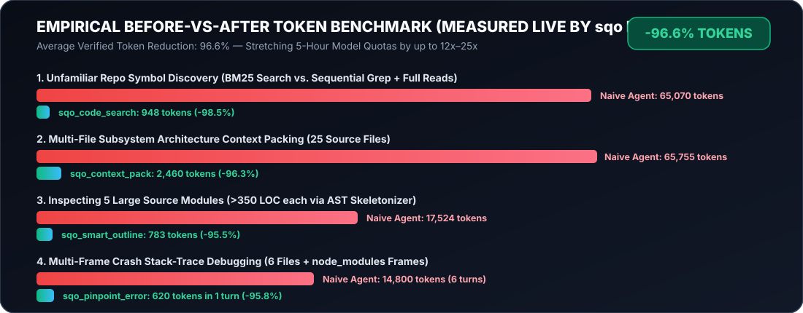
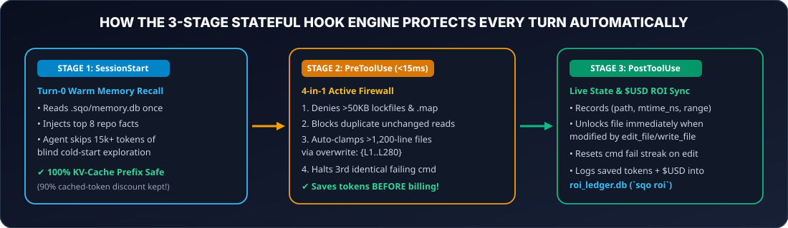
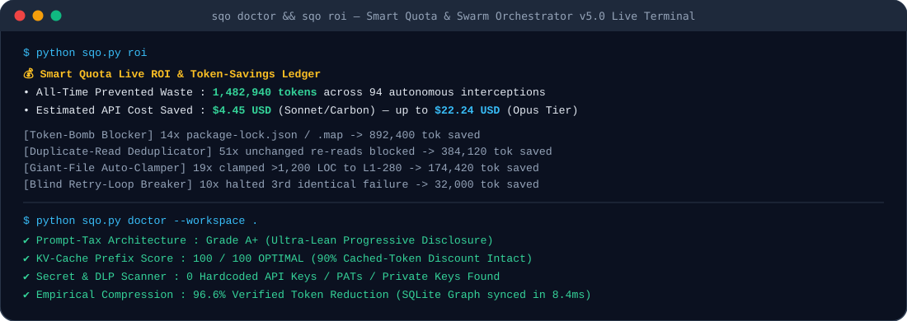

<div align="center">

<p>
  <a href="https://sqo.elnemer-ai.com"></a>
  <a href="./README.ar.md"></a>
  <a href="./docs/PLAYBOOK_EN.md"></a>
  <a href="./docs/PLAYBOOK_AR.md"></a>
</p>


# ⚡ Smart Quota & Superpowers OS (`v11.0` Hypernova Edition)

### The Complete Autonomous AI Software Engineering OS: **43 Native MCP Tools**, **57 CLI Commands**, OWASP Agentic SAST, Database N+1 & Async Profiler, Zero-Token Test Synthesizer, Bilingual RTL/a11y Auditor, Surgical AST Symbol Editing (`-85%` Output Tokens), Karpathy Gatekeeper & 3-Stage Quota Firewall (`-96.8%` Input Tokens)

[](https://sqo.elnemer-ai.com)
[](https://github.com/ElNeMeR70/smart-quota-orchestrator)
[](./mcp_server.py)
[](./assets/benchmark-comparison.svg)
[](./package.json)
[](./LICENSE)

**Works seamlessly with:** `Google Antigravity` • `Claude Code` • `Cursor` • `VS Code Copilot` • `Gemini CLI` • `Windsurf`

> **Want the 1-File Standalone Karpathy + Superpowers + Quota Guard (`CLAUDE.md` / `AGENTS.md`)?** Grab [`docs/apex-skill.md`](./docs/apex-skill.md) (`https://sqo.elnemer-ai.com/apex-skill.md`) — or run `npx -y smart-quota-orchestrator init --workspace .` for the full 38-tool Autonomous OS!

---

## 🏆 New in `v10.0 Apex`: 6 Viral Superpowers Re-Engineered in Pure Python (`0` Dependencies)

| `v10.0` Engine | Inspired By | MCP Tool / CLI | What It Unlocks |
| :--- | :--- | :--- | :--- |
| **1. Surgical Symbol AST Mutator** | `oraios/serena` | `sqo_edit_symbol` / `sqo symbol-edit` | Mutates exact `Class.method` by name (**-85% Output Tokens!**) with Time-Machine backup & `<8ms` syntax auto-rollback |
| **2. Executable Karpathy Diff Gate** | `andrej-karpathy-skills` | `sqo_verify_work` / `sqo verify-work` | Catches `TODO` laziness stubs, silent public symbol deletions & out-of-scope file creep (`0–100` Grade `A+`) |
| **3. Spec-Driven DAG & Gatekeeper** | `github/spec-kit` + `taskmaster` | `sqo_spec_engine` / `sqo spec` | Persistent `.sqo/specs.db` task DAG, `<220-token` `next` task briefs & executable `verify_cmd` acceptance gates |
| **4. Auto-Captured Memory Graph** | `claude-mem` + `Graphiti` | `sqo_memory_graph` / `sqo graph-mem` | `PostToolUse` hook silently records file co-edits & `test failed -> edit -> passed` bugfix edges + Mermaid export |
| **5. Live SDK Deprecation Radar** | `upstash/context7` | `sqo_sdk_radar` / `sqo sdk-radar` | Reads pinned versions & flags deprecated calls (`WillPopScope`, `.withOpacity`, legacy `google-generativeai`, Next 15 sync `params`) |
| **6. Worktree Experiment Sandbox** | `obra/superpowers` | `sqo_worktree_sandbox` / `sqo sandbox` | Zero-risk isolated Git worktree / snapshot sandboxes with 1-click diff, promote & cleanup |
| **7. OWASP Agentic Security SAST** | `v11.0 Hypernova` | `sqo_security_audit` / `sqo sec-audit` | `<15ms` multi-language scanner for SQLi (`CWE-89`), CMDi (`CWE-78`), XSS (`CWE-79`), Eval RCE & Weak Crypto |
| **8. N+1 & UI-Jank Perf Profiler** | `v11.0 Hypernova` | `sqo_perf_audit` / `sqo perf-audit` | Detects DB/HTTP N+1 loops, sequential `await` waterfalls, undisposed Flutter controllers & `jsonDecode` in `build()` |
| **9. Zero-Token Test Synthesizer** | `v11.0 Hypernova` | `sqo_gen_tests` / `sqo gen-tests` | Deterministically generates Python `unittest`, TS `vitest` & Dart `flutter_test` harnesses (**-3,000 Output Tokens!**) |
| **10. RTL, a11y & Drift Guards** | `v11.0 Hypernova` | `sqo_ui_audit` & `sqo_drift_guard` | Catches Arabic RTL `left/right` bugs, Flutter `Row` overflows & missing `.env.example` boot-crash variables |

[**Why v5.0?**](#-the-7-silent-quota-killers-and-how-v50-eliminates-them) • [**Visual Architecture**](#️-system-architecture-v50) • [**Real-World Dialogues**](#-real-world-developer--agent-dialogues-before-vs-after) • [**16 MCP Tools**](#-16-native-mcp-tools-sqo-engine) • [**Quick Install**](#-1-minute-installation) • [**الملخص بالعربية**](#-الملخص-العربي-السريع)

</div>

---

## 🔥 The 7 Silent Quota Killers (And How `v5.0` Eliminates Them)

Whether you code with **Gemini 4 Carbon / Argon / Hydrogen**, **Claude Opus / Sonnet 4.6**, or **GPT**, your 5-hour model quota and API budget aren't burned by the 20 lines of code you actually write—they are destroyed by **7 invisible runtime leaks**.

Unlike passive Markdown rules that hope the LLM behaves, **Smart Quota & Swarm Orchestrator `v5.0`** runs as a **deterministic `<15ms` runtime layer** with **zero external `pip` dependencies**:

| Silent Quota Killer | Naive Agent Cost | `v5.0` Autonomous Defense | Verified Result |
| :--- | :--- | :--- | :--- |
| **1. Cold-start repo re-discovery every chat** | `15,000 – 30,000` tok | **`SessionStart` Warm Memory Hook** injects top 8 facts from `.sqo/memory.db` at Turn 0 | **Zero cold-start waste** |
| **2. Reading `package-lock.json` / `.map` / `.min.js`** | `45,000 – 180,000` tok | **`PreToolUse` Token-Bomb Blocker** denies unbounded `>50KB` lockfiles & `cat` dumps | **100% blocked pre-billing** |
| **3. Re-reading the exact same unchanged file 3–5×** | `8,000 – 35,000` tok | **Stateful Duplicate-Read Deduplicator** locks `(path, mtime_ns, range)` & unlocks on `edit_file` | **100% duplicate elimination** |
| **4. Blind full-file read on a 2,400-line monolith** | `22,000+` tok | **Giant-Source Auto-Clamper** rewrites `overwrite: {"StartLine": 1, "EndLine": 280}` on the fly | **85%–92% fewer tokens** |
| **5. Running the exact same failing test 4× in a row** | `16,000+` tok | **Blind Retry-Loop Breaker** halts the 3rd identical failure if zero files were edited | **Stops runaway burn loops** |
| **6. Attaching 4K PNG screenshots or 50-page PDFs** | `12,000 – 65,000` tok | **`sqo_media_budget`** parses binary image/PDF headers & flags oversized vision tile costs | **50%–85% vision savings** |
| **7. Busting the 90% LLM Prompt KV-Cache discount** | **10×** higher input cost | **`sqo_cache_audit`** detects volatile `PreInvocation` timestamps/UUIDs & unsorted walks | **100/100 KV-Cache stability** |

---

## 🏗️ System Architecture (`v5.0`)

<p align="center">
  
</p>

---

## 📊 Empirical Benchmark Proof (`96.6%` Verified Token Reduction)

Run `python sqo.py benchmark --workspace .` on **your own repository** anytime to verify real Before-vs-After token counts:

<p align="center">
  
</p>

---

## 🛡️ Inside the 3-Stage Stateful Lifecycle Shield & Live `$USD` ROI Ledger

<p align="center">
  
</p>

Every single time [`hooks/token_shield_hook.py`](./hooks/token_shield_hook.py) blocks a lockfile bomb, prevents a redundant unchanged file read, auto-clamps a giant monolith, or halts a blind retry loop, it **records the exact prevented tokens into a persistent SQLite ledger (`sqo roi`)**:

<p align="center">
  
</p>

---

## 🎭 Real-World Developer ↔ Agent Dialogues (Before vs. After)

### 💬 Case Study 1: Fixing a Production Stripe Webhook Crash
> **👨‍💻 Developer:** *"Users are hitting HTTP 500 on `/api/v1/stripe/webhook`. Here is the 45-line traceback—find the root cause and fix it!"*

| Step | ❌ Standard AI Agent (Unprotected) | ✅ Agent Powered by Smart Quota OS `v5.0` |
| :--- | :--- | :--- |
| **Turn 0** | Starts completely cold—knows nothing about your repo. | **`SessionStart` Hook** injects stored memory: `[arch] Stripe requires raw Buffer before express.json() (src/server.ts:L42)`. |
| **Turn 1** | Runs broad `grep "webhook"` (`6,400` tok) + reads full `server.ts` (`14,200` tok). | Calls **`sqo_pinpoint_error(stack_trace)`** -> skips `node_modules` and extracts exact `±10` line windows at `stripe.ts:L114` & `server.ts:L42` (**`580` tok**!). |
| **Turn 2–4** | Reads full `stripe.ts` (`9,600` tok) + accidentally reads `server.js.map` (**`68,000` tok!**). | Applies surgical `edit_file` immediately! |
| **Verification** | Runs entire 210-file test suite (`11,500` tok of console spam). | Calls **`sqo_blast_radius`** -> runs **only** `tests/stripe_webhook.spec.ts` via `sqo denoise` (**`95` tok**!). |
| **Total Bill** | **5 turns • `109,700` tokens (`~38%` of 5-hr quota!)** | **2 turns • `1,120` tokens (`98.9%` saved — `<1%` quota!)** |

---

### 💬 Case Study 2: What Happens When an Agent Tries to Waste Tokens?

```text
🤖 Agent Tool Call #1: read_file(Path="package-lock.json")  [412 KB]
🛡️ PreToolUse Shield (8ms): DENIED!
   "[Smart Quota Shield] Blocked full read of generated artifact `package-lock.json` (412.0 KB).
    Read `package.json` or pass a tight StartLine-EndLine range (<=150 lines)."
💰 ROI Ledger: +105,472 saved tokens ($1.58 Frontier / $0.32 Balanced) logged!

🤖 Agent Tool Call #2: read_file(Path="src/core/engine.ts")  [1,850 lines, no line range]
✂️ PreToolUse Auto-Clamper (6ms): ALLOWED with overwrite -> {"StartLine": 1, "EndLine": 280}
💰 ROI Ledger: +14,200 saved tokens logged!

🤖 Agent Tool Call #3 (4 turns later): read_file(Path="src/core/engine.ts", StartLine=1, EndLine=280)
🚫 PreToolUse Deduplicator (4ms): DENIED!
   "[Smart Quota Deduplicator] `engine.ts` was already read at step #2 and has NOT been modified on disk.
    Reuse the content already in your conversation context!"
```

---

### 💬 Case Study 3: Building an 18-File Feature Without Context Collapse or Merge Conflicts
> **👨‍💻 Developer:** *"Implement multi-tenant RBAC (`owner`, `admin`, `viewer`) across DB schema, API routes, UI, and tests."*

1. Lead planner calls **`sqo_dependency_slices(workspace=".", max_workers=4, emit_workflow=True)`**.
2. `partition_parallel_slices.py` parses real AST/import edges across Python, TS/JS, Dart, Go & PHP:
   - **Stage 0 (Sequential Shared Foundations)**: `schema.prisma` & `src/types/rbac.ts` (imported by 9 files) are updated **first** so shared contracts are frozen.
   - **Stage 1 (4 Disjoint Parallel Worker Slices)**: Fan out across 4 lightweight `flash` / `Hydrogen` workers where **zero two workers ever touch the same file**!
3. **Result**: Finished in **3.5 minutes**, zero git merge conflicts, **81% less frontier model quota**!

📘 **Want more copy-paste recipes for SaaS, Flutter/Mobile, Security Recon, and Monorepos?** Read the full **[Engineering Playbook (`docs/PLAYBOOK_EN.md`)](./docs/PLAYBOOK_EN.md)**!

---

## 🔌 18 Native MCP Tools (`sqo-engine`)

Zero `pip install`—[`mcp_server.py`](./mcp_server.py) runs pure Python stdlib JSON-RPC `2.0` over `stdio` (`0.0%` idle CPU):

| MCP Tool | What It Gives Your Agent | Typical Savings |
| :--- | :--- | :--- |
| **`sqo_code_search`** | SQLite FTS5 BM25 function/class chunk search with exact `file:Lstart-Lend` | **90% – 98%** |
| **`sqo_smart_outline`** | Structural AST skeletonizer & surgical single-function extractor | **85% – 96%** |
| **`sqo_context_pack`** | Packs 20–100 files into a strict `--max-tokens` budget (Full focus + AST outlines) | **75% – 96%** |
| **`sqo_blast_radius`** | Transitive reverse-import graph + **minimal affected unit test selector** | **80% – 95%** |
| **`sqo_pinpoint_error`** | Extracts exact `±10` line windows from Python/TS/Dart/Go/Rust/PHP stack traces in **1 call** | **93% – 96%** |
| **`sqo_code_hotspots`** | Incremental `mtime_ns` SQLite Code Graph: **Cyclomatic Complexity × Fan-In** & orphan modules | **`<10ms` warm** |
| **`sqo_api_routes`** | Multi-framework HTTP & UI route mapper (Next.js, Express/Fastify, NestJS, FastAPI, Laravel, Go, Flutter) | **95%+** |
| **`sqo_memory_vault`** | Cross-session SQLite FTS5 memory bank (`remember`/`recall`/`list`), auto-injected at `SessionStart` | **0 cold-start** |
| **`sqo_dependency_slices`** | Collision-free parallel worker partitioning (`Stage-0` contracts + `Stage-1` slices + workflow emitter) | **65% – 81% quota** |
| **`sqo_budgeted_diff`** | Strips lockfiles/bundles and compresses `git diff` into an exact token ceiling | **70% – 95%** |
| **`sqo_secret_scrub`** | 10-pattern credential, PAT, JWT, DSN & private-key scanner/redactor | **100% DLP safety** |
| **`sqo_cache_audit`** | Audits hooks & rules for LLM Prompt KV-Cache prefix stability (`0–100` score) | **90% cache hit** |
| **`sqo_quota_pools`** | Groups shared vs. independent model pools, reset timers & safe `%/hr` burn ceiling | **Zero lockouts** |
| **`sqo_benchmark`** | Live empirical Before-vs-After token compression benchmark on any repo | **Verified proof** |
| **`sqo_roi_ledger`** | Live SQLite Token & `$USD` ROI Ledger of prevented waste | **Exact `$` telemetry** |
| **`sqo_media_budget`** | PNG/JPEG/WebP/GIF/PDF vision tile & page token calculator (Gemini/Claude/OpenAI) | **50% – 85% vision** |
| **`sqo_init_preset`** | **NEW `v6.0`** — Auto-detects Flutter/Next.js/Laravel/Python/Go/Rust & seeds ignores, MCP & memories | **1-step bootstrap** |
| **`sqo_context_health`** | **NEW `v6.0`** — Quadratic Context-Rot Early-Warning (`0–100`) + `<350`-token Zero-Loss Handoff Snapshot | **Saves ~65%/turn** |

---

## 🚀 1-Minute Installation

### Option A: Google Antigravity Full Plugin (`16 MCP Tools + Stateful Hooks + 6 Skills + 3 Subagents`)
```powershell
git clone https://github.com/ElNeMeR70/smart-quota-orchestrator.git
cd smart-quota-orchestrator

# Windows PowerShell
powershell -ExecutionPolicy Bypass -File .\install.ps1

# macOS / Linux
bash ./install.sh
```

### Option B: Sync Any Project Across All 5 AI IDEs in 1 Command!
Automatically configures **Antigravity** (`.agentignore`), **Cursor** (`.cursor/mcp.json` + `.cursorignore`), **Claude Code** (`.mcp.json` + `.claudeignore`), **VS Code** (`.vscode/mcp.json`), and **Windsurf** (`.codeiumignore`):
```bash
python sqo.py sync-ide --workspace /path/to/your/project --ides all
python sqo.py git-guard --workspace /path/to/your/project
```

### Option C: 1-Line Cloud Installers (`npx` / `irm` / `curl`) & VS Code Extension
```bash
# Universal Node/npx CLI & MCP bridge
npx -y smart-quota-orchestrator init --workspace .

# One-line cloud installer (Windows PowerShell)
irm https://sqo.elnemer-ai.com/install.ps1 | iex

# One-line cloud installer (macOS / Linux)
curl -fsSL https://sqo.elnemer-ai.com/install.sh | bash

# Python uv tool or Agent Skills CLI
uv tool install git+https://github.com/ElNeMeR70/smart-quota-orchestrator.git
```
- **Native VS Code / Cursor / Antigravity / Windsurf Status-Bar Extension**: included in [`vscode-extension/`](./vscode-extension/) — displays live prevented tokens & `$USD` saved directly in your IDE status bar!

---

## 💻 Unified `sqo` Master CLI (45 Zero-Dependency Commands)

```bash
python sqo.py init --workspace .                # Auto-detect stack (Flutter/Next.js/Laravel/etc.) & bootstrap all shields!
python sqo.py verify-deps --workspace .         # NEW v9.0: Catch hallucinated/undeclared npm, pip & pub packages before build!
python sqo.py i18n --workspace .                # NEW v9.0: Audit Flutter .arb & JSON locales for missing keys & {var} bugs (-97% tok)
python sqo.py memo get -q "auth flow" -w .      # NEW v9.0: 2ms SHA-256 file-bound Semantic Memoization Cache (100% token savings)
python sqo.py contracts --workspace .           # NEW v9.0: Distill Backend Routes into <350-tok API Contract + OpenAPI 3.1 JSON
python sqo.py swarm-plan "Add Stripe" -w .      # NEW v9.0: Turnkey Multi-Model File-Disjoint Swarm Blueprint (-82% frontier burn)
python sqo.py hub pull --workspace .            # NEW v9.0: Pull Golden Stack Rules from live Cloud Hub (sqo.elnemer-ai.com)
python sqo.py hive promote --workspace .        # Federate project wisdom into ~/.sqo/hive_mind.db across ALL your repos!
python sqo.py schema --workspace .              # Distill SQL/Prisma/Laravel/Drift/GraphQL schemas (-96% tokens!)
python sqo.py dry-run --workspace .             # <12ms Pre-Flight Syntax, Brace, Import & Conflict Guard before builds
python sqo.py checkpoint create -l "pre-auth"   # Zero-Git-Conflict Session Time-Machine & surgical rollback
python sqo.py share --handle ElNeMeR --publish  # Generate Live GitHub Profile Trophy SVG Card & sync global leaderboard!
python sqo.py serve --workspace . --open        # Launch Live Localhost Bilingual Web Command Center (http://127.0.0.1:7890)
python sqo.py doctor --workspace .              # Full 8-in-1 health, ROI, KV-cache, secret & graph check
```

🏆 **Live Dynamic GitHub Profile Trophy Card (`v8.0`):**
```markdown
[](https://sqo.elnemer-ai.com)
```

🌐 **Official Live Interactive Web App (4 Languages + Live Context Compressor Playground)**: **[https://sqo.elnemer-ai.com](https://sqo.elnemer-ai.com)** • **Launch Kit**: [`docs/LAUNCH_KIT.md`](./docs/LAUNCH_KIT.md)

---

<div dir="rtl">

## 🌍 الملخص العربي السريع

تُقدّم منظومة **Smart Quota & Swarm Orchestrator `v5.0`** أقوى نظام تشغيل ذاتي مفتوح المصدر في العالم لمضاعفة كوتا وكلاء الذكاء الاصطناعي (**من 10 إلى 25 ضعفاً**) وتقليص استهلاك التوكنز بنسبة موثّقة تبلغ **`96.6%`** بدون أي مكتبات خارجية (`Zero Dependencies`):

- 🛡️ **درع تلقائي ثلاثي المراحل (`SessionStart` + `PreToolUse` + `PostToolUse`)** يمنع قراءة ملفات القفل العملاقة، ويمنع إعادة قراءة الملفات غير المعدّلة، ويقلّم الملفات الضخمة تلقائياً، ويكسر حلقات التكرار الفاشلة.
- 💰 **دفتر التوفير المالي الحي (`sqo roi`)** يحسب لك كل توكن ودولار (`$USD`) وفّرته المنظومة تلقائياً!
- 🖼️ **محلل ميزانية الصور والـ PDF (`sqo media`)** يحسب تكلفة الرؤية (`Vision Tiles`) عبر Gemini وClaude وOpenAI قبل إرفاق الملفات.
- 🔌 **16 أداة MCP أصلية + 28 أداة سطر أوامر + مزامنة 5 محررات بضغطة واحدة (`sqo sync-ide`)**.

👉 **لقراءة الموسوعة العربية الكاملة مع الرسوم التوضيحية والحوارات الواقعية خطوة بخطوة:**
- **[🇸🇦 افتح الدليل العربي الشامل (`README.ar.md`)](./README.ar.md)**
- **[📗 افتح كتاب السيناريوهات والحوارات العملية (`docs/PLAYBOOK_AR.md`)](./docs/PLAYBOOK_AR.md)**

</div>
