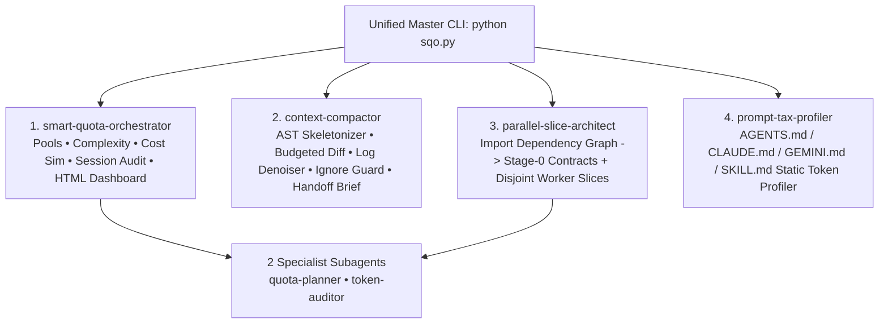

<div align="center">
  

  # Smart Quota & Swarm Orchestrator `v2.0`

  **The Complete 12-Tool AI Quota, Multi-Agent Partitioning & Context Engineering Suite.**  
  *Cut AI coding token & quota burn by 50–85% without sacrificing frontier reasoning.*

  [](#quick-install)
  [](LICENSE)
  [-38BDF8.svg)](#the-12-bundled-cli-tools--master-sqo-cli)
  [](#suite-architecture)

  Works natively as a **Google Antigravity Plugin**, **Universal `npx skills` Collection**, **Claude Code Plugin**, **Cursor / Windsurf Skill**, and **Gemini CLI Extension**.

  [Quick Install](#quick-install) • [12 CLI Tools (`sqo`)](#the-12-bundled-cli-tools--master-sqo-cli) • [4 Bundled Skills](#suite-architecture) • [الشرح الكامل بالعربية](#-الدليل-الكامل-بالعربية-إصدار-v20)
</div>

---

## Why Developers Need This Suite

Frontier models (**Gemini 4 Carbon**, **Claude Opus 4.6**, etc.) lose 60–85% of their quota on **avoidable context taxes**:
- Reading entire 1,500-line files just to inspect a single 20-line function.
- Re-sending bloated `AGENTS.md` / `CLAUDE.md` rules and verbose `npm test` / `git diff` lockfile dumps on **every subsequent turn** ($O(T^2)$ cumulative token billing!).
- Launching parallel agents without import-graph partitioning, causing merge collisions and 5+ rework turns.
- Draining a shared primary quota pool to `0%` while secondary model pools sit at `100%` untouched.

**Smart Quota & Swarm Orchestrator v2.0** solves every layer of this problem with **12 deterministic, zero-dependency Python CLI tools**, **4 modular skills**, and **2 read-only specialist subagents**.

---

## Suite Architecture



| Bundle Layer | Included Items |
| :--- | :--- |
| **4 Modular Skills** | `smart-quota-orchestrator` • `context-compactor` • `parallel-slice-architect` • `prompt-tax-profiler` |
| **2 Specialist Subagents** | `quota-planner` *(dependency-safe task decomposer)* • `token-auditor` *(repo & transcript waste hunter)* |
| **Always-On Guardrail** | `rules/AGENTS.md` *(ultra-lean <250-token targeted-read & anti-thrashing invariants)* |
| **Unified Master CLI** | `sqo.py` *(13 subcommands including full-spectrum `sqo doctor` + HTML telemetry report)* |

---

## Quick Install

### Option 1 — Universal Agent Skills CLI (Claude Code, Cursor, Antigravity, Codex, Windsurf)

```bash
# Install all 4 skills in one command
npx skills add ElNeMeR70/smart-quota-orchestrator

# Or preview the 4 skills in the collection
npx skills add ElNeMeR70/smart-quota-orchestrator --list
```

### Option 2 — Google Antigravity Full Plugin Bundle (4 Skills + 2 Subagents + Rules)

**Windows (PowerShell):**
```powershell
git clone https://github.com/ElNeMeR70/smart-quota-orchestrator.git
powershell -ExecutionPolicy Bypass -File .\smart-quota-orchestrator\install.ps1
```

**macOS / Linux:**
```bash
git clone https://github.com/ElNeMeR70/smart-quota-orchestrator.git
bash ./smart-quota-orchestrator/install.sh
```

---

## The 12 Bundled CLI Tools & Master `sqo` CLI

Every tool uses **100% Python 3.8+ standard library** (zero `pip` packages required, cross-platform Windows/macOS/Linux):

| # | `sqo.py` Command | Underlying Script | What It Does & Token Impact |
| :--- | :--- | :--- | :--- |
| **1** | `sqo doctor` | *(5-in-1 Orchestrated Check)* | Runs Prompt-Tax, Ignore-Guard, Complexity, and Dependency Slice diagnostics in one pass |
| **2** | `sqo pools` | `parse_quota_pools.py` | Groups shared vs. reserve model pools, calculates reset timers & safe `%/hr` burn rate |
| **3** | `sqo complexity` | `analyze_task_complexity.py` | Scores task complexity (`0–100`), risk domains, & parallelizability (`0.0–1.0`) |
| **4** | `sqo simulate` | `simulate_workflow_cost.py` | Simulates $O(T^2)$ monolithic frontier burn vs `Orchestrator` & `run_workflow(flash)` |
| **5** | `sqo slice` | `partition_parallel_slices.py` | Parses real Python/TS/JS/Dart/Go/PHP imports into Stage-0 contracts + disjoint worker slices (`--emit-workflow`) |
| **6** | `sqo outline` | `smart_outline.py` | Extracts class/function signatures + exact `Lstart-Lend` ranges (**saves 85–96% tokens** vs full reads!) |
| **7** | `sqo diff` | `compress_git_diff.py` | Strips lockfiles/bundles/SVGs and compresses `git diff` cleanly into `--max-tokens` |
| **8** | `sqo denoise` | `compact_command_output.py` | Filters `pytest`/`jest`/`vitest`/`npm test`/`tsc` spam down to failing lines (**saves 80–95%**) |
| **9** | `sqo prompt-tax` | `optimize_prompt_rules.py` | Grades `AGENTS.md` / `CLAUDE.md` / `GEMINI.md` / `SKILL.md` per-turn static token overhead (`A+` to `D`) |
| **10** | `sqo ignore-guard` | `generate_agent_ignore.py` | Finds heavy sourcemaps/dumps and writes `.agentignore` / `.cursorignore` / `.claudeignore` |
| **11** | `sqo audit` | `audit_session_burn.py` | Audits Antigravity & Claude Code JSONL transcripts for duplicate unchanged reads & retry loops |
| **12** | `sqo handoff` | `build_handoff_brief.py` | Builds a `<400-token` zero-loss git & workspace brief before `/compact` or subagent handoff |
| **13** | `sqo dashboard` | `generate_html_dashboard.py` | Generates a self-contained dark-glassmorphism `quota-dashboard.html` report |

### Quick CLI Examples

```bash
# Run full 5-in-1 workspace quota & context health check
python sqo.py doctor --workspace .

# Read a 2,000-line file's complete class/function map in <120 tokens
python sqo.py outline src/services/billing.ts
python sqo.py outline src/services/billing.ts --symbol verifyStripeSignature

# Partition repo imports & auto-generate an Antigravity parallel run_workflow script
python sqo.py slice --workspace . --max-workers 4 --goal "Add RBAC audit logs" --emit-workflow

# Run a noisy test suite and feed ONLY actionable failures back to the agent
python sqo.py denoise --cmd "npm test"

# Compress git diff to <= 1,500 tokens (auto-stripping package-lock / dist / .map)
python sqo.py diff --workspace . --max-tokens 1500

# Generate an interactive visual HTML telemetry dashboard
python sqo.py dashboard --workspace . --output quota-dashboard.html
```

### Run Automated Test Suite

```bash
python -m unittest discover -s tests -v
```

---

<div dir="rtl">

## 🚀 الدليل الكامل بالعربية (إصدار `v2.0`)

منظومة **Smart Quota & Swarm Orchestrator v2.0** لم تعد مجرد مهارة واحدة، بل أصبحت **حقيبة أدوات هندسية متكاملة (4 مهارات + وكيلين متخصصين + 12 أداة CLI بـ Python بدون أي مكتبات خارجية)** لتوفير **50% إلى 85%** من استهلاك الكوتا والتوكنز.

### ماذا أُضيف في الإصدار `v2.0`؟
1. **الأداة الموحدة السريعة (`sqo.py`):** نقطة تشغيل واحدة تضم 13 أمراً جاهزاً منها أمر الفحص الشامل `python sqo.py doctor`.
2. **قارئ الهياكل الذكي (`sqo outline`):** بدلاً من قراءة ملف طوله 2000 سطر واستهلاك آلاف التوكنز، يستخرج كل الـ Classes والـ Functions بأرقام الأسطر الدقيقة `Lstart-Lend` في أقل من 5% من الحجم، مع إمكانية استخراج دالة بعينها بـ `--symbol`!
3. **مُقسّم التوازي المبني على شجرة الـ Imports (`sqo slice`):** يحلل جمل `import` الفعلية في (Python / TS / JS / Dart / Go / PHP) ليفصل ملفات العقود المشتركة (Stage 0) عن مسارات العمل المتوازية المستقلة (Stage 1)، ويولّد كود `run_workflow` جاهزاً للتنفيذ بدون أي تضارب (Zero Merge Conflicts).
4. **ضاغط فروقات Git الذكي (`sqo diff`):** يحذف تلقائياً ملفات الـ Lockfiles والملفات المضغوطة ويرتب التعديلات حسب الأهمية الأمنية والمنطقية داخل سقف توكنز محدد (`--max-tokens`).
5. **منقّي مخرجات الاختبارات والـ Build (`sqo denoise`):** يشغّل أوامر الاختبار المزعجة ويحذف 90% من سطور النجاح المكررة وأكواد الألوان ليُبقي فقط سطر الخطأ الحقيقي.
6. **مُحلل ضريبة القواعد الثابتة (`sqo prompt-tax`):** يقيس عدد التوكنز التي تسحبها ملفات `AGENTS.md` و `CLAUDE.md` و `GEMINI.md` في كل رسالة، ويعطي تقييماً معمارياً من `A+` إلى `D`.
7. **حارس الملفات الثقيلة (`sqo ignore-guard`):** يكتشف ملفات الـ SourceMaps وقواعد البيانات الضخمة وينشئ ملف `.agentignore` أو `.cursorignore` تلقائياً.
8. **محاكي تكلفة الكوتا (`sqo simulate`) + لوحة HTML التفاعلية (`sqo dashboard`):** يولّد صفحة `quota-dashboard.html` تفاعلية بتصميم Dark Glassmorphism تعرض حالة المشروع والكوتا وتوزيع المهام.

</div>

---

## License

Released under the [MIT License](LICENSE) by [ElNeMeR](https://github.com/ElNeMeR70).
