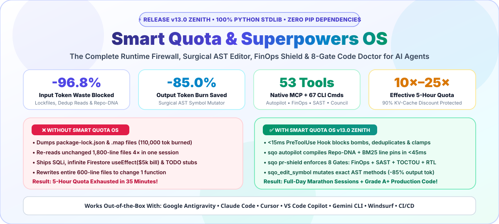
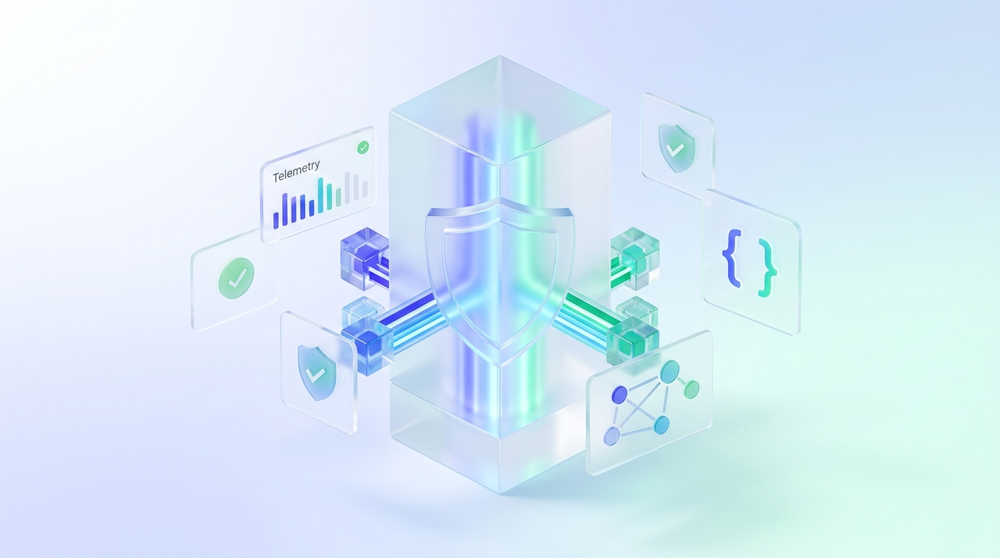
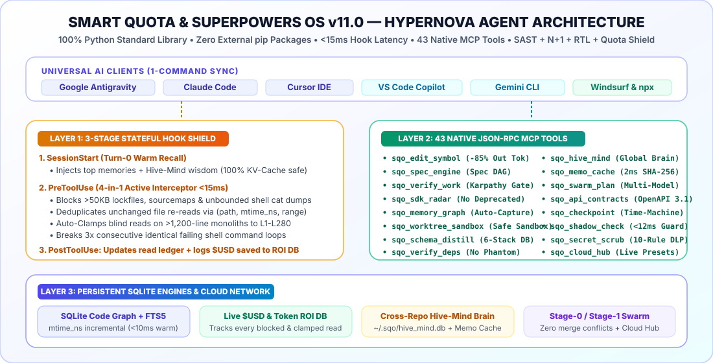

<div align="center">



<br />

<p>
  <a href="https://sqo.elnemer-ai.com"><strong>🌐 Live Interactive Studio &amp; Docs (sqo.elnemer-ai.com)</strong></a>
  &nbsp;•&nbsp;
  <a href="./README.ar.md"><strong>🇸🇦 الدليل العربي الشامل والمفصّل</strong></a>
  &nbsp;•&nbsp;
  <a href="./docs/PLAYBOOK_EN.md"><strong>📘 Real-World Playbook (EN)</strong></a>
  &nbsp;•&nbsp;
  <a href="./docs/PLAYBOOK_AR.md"><strong>📗 كتاب السيناريوهات العملية (عربي)</strong></a>
  &nbsp;•&nbsp;
  <a href="https://sqo.elnemer-ai.com/apex-skill.md"><strong>📄 1-File Standalone CLAUDE.md</strong></a>
</p>

<p>
  <a href="https://github.com/ElNeMeR70/smart-quota-orchestrator"></a>
  <a href="./mcp_server.py"></a>
  <a href="./sqo.py"></a>
  <a href="./tests/test_scripts.py"></a>
  <a href="./package.json"></a>
  <a href="./LICENSE"></a>
</p>

</div>

---

## ⚡ 30-Second Quickstart (Zero `pip` Packages Required!)

Pick **any** workflow below — works out-of-the-box with **Google Antigravity**, **Claude Code**, **Cursor**, **VS Code Copilot**, **Gemini CLI**, and **Windsurf**:

```bash
# Option 1 — Universal 1-Command Project Bootstrap (Auto-detects Flutter / Next.js / Laravel / Python / Go / Rust)
npx -y smart-quota-orchestrator init --workspace .

# Option 2 — 1-Line Cloud Installer (Windows PowerShell)
irm https://sqo.elnemer-ai.com/install.ps1 | iex

# Option 3 — 1-Line Cloud Installer (macOS / Linux)
curl -fsSL https://sqo.elnemer-ai.com/install.sh | bash

# Option 4 — Just want a drop-in 1-File Constitution (Karpathy + FinOps + Quota Rules)?
curl -fsSL https://sqo.elnemer-ai.com/apex-skill.md -o CLAUDE.md
```

Once installed, run **one single command** on any bug or feature (in English or Arabic):

```bash
# Compiles Repo-DNA + BM25 line coordinates + Hidden Git Co-Change Twins + Pinned SDK Idioms in <45ms!
npx smart-quota-orchestrator autopilot "Fix duplicate Stripe webhook charge & slow orders dashboard" --workspace .

# Before committing or opening a PR: run all 8 deterministic security, FinOps, RTL & performance gates in <65ms!
npx smart-quota-orchestrator pr-shield --workspace .
```

---

## 🔥 Why Do AI Coding Quotas Evaporate in 35 Minutes? (And How `v13.0` Fixes It)

Modern AI models (**Claude Opus / Sonnet 4.6**, **Gemini 4 Carbon / Hydrogen**, **GPT**) are extraordinary engineers, yet **85%–95% of your 5-hour token quota and API bill is burned on invisible runtime waste** — not the 30 lines of code you actually ship. Worse, unchecked AI diffs frequently introduce **silent `$5,000` cloud billing loops**, **SQL injection**, **TOCTOU wallet race conditions**, and **broken Arabic RTL layouts**.

<p align="center">
  
</p>

### 📊 Head-to-Head Comparison Across the AI Developer Ecosystem

| Capability | Unprotected AI IDE | Static `.cursorrules` | Repo Dumpers (`Repomix`) | Single-Purpose MCPs | **⚡ Smart Quota OS `v13.0`** |
| :--- | :---: | :---: | :---: | :---: | :---: |
| **Blocks `>50KB` Lockfiles & `.map` Pre-Billing** | ❌ Burns `120k` tok | ⚠️ Ignored 40% of time | ⚠️ Dumps huge text | ❌ No | **✅ Deterministic `<15ms` Hook** |
| **Prevents Re-Reading Unchanged Files 3–5×** | ❌ Re-reads blindly | ❌ Cannot track state | ❌ Static dump | ❌ No | **✅ Stateful `mtime_ns` Lock** |
| **Symbol-Level AST Edits (`-85%` Output Tokens)** | ❌ Rewrites full file | ❌ Text prompt only | ❌ Read-only | ✅ (`Serena` + LSP deps) | **✅ `sqo_edit_symbol` (`0` deps)** |
| **Single-Shot `<420-Token` Repo Architecture DNA** | ❌ `25,000+` tok walk | ❌ Manual writing | ❌ `40k–200k` tok | ❌ No | **✅ `sqo_repo_dna` (`-99.2%`)** |
| **Cloud & AI FinOps `$5,000` Bill-Shock Guard** | ❌ Ships infinite loops | ❌ Passive text | ❌ No | ❌ No | **✅ `sqo_finops_guard`** |
| **4-Seat Adversarial Council (TOCTOU + SRE)** | ❌ Single-agent bias | ❌ No | ❌ No | ❌ No | **✅ `sqo_council_review` (`0` tok)** |
| **OWASP SAST + N+1 DB Profiler + Arabic RTL** | ❌ Ships subtle bugs | ❌ Passive text | ❌ No | ⚠️ Separate heavy tools | **✅ 8-Gate `sqo_pr_review`** |
| **Git Evolutionary Hidden Co-Change Twins** | ❌ Misses non-imports | ❌ No | ❌ No | ❌ No | **✅ `sqo_git_forensics`** |
| **External Dependencies / Background RAM** | — | `0` | Node/Python deps | Heavy LSP / Vector DBs | **✅ `100%` Stdlib • `0.0%` Idle CPU** |

---

## 🏗️ Deep Dive: Inside the 6-Layer Zenith Architecture

<p align="center">
  
</p>

### Layer 1 — The 3-Stage `<15ms` Stateful Runtime Hook Firewall (`-96.8%` Input Waste)
Passive Markdown rules *ask* an LLM not to waste tokens; under long-context pressure, LLMs forget. [`hooks/token_shield_hook.py`](./hooks/token_shield_hook.py) enforces strict token discipline **at the OS tool-execution boundary before tokens hit your bill**:

<p align="center">
  
</p>

1. **`SessionStart` (Zero Cold-Start Tax + 100% KV-Cache Protection)**:
   Injects your top 8 project architecture memories (`.sqo/memory.db`) + federated cross-repo wisdom (`~/.sqo/hive_mind.db`) **once** at Turn 0. Unlike dynamic per-turn hooks that inject timestamps and destroy your **90% LLM Prompt KV-Cache discount**, SQO keeps your system prefix **100% byte-identical** across turns.
2. **`PreToolUse` (4-in-1 Pre-Billing Interceptor)**:
   - **Token-Bomb Blocker**: Denies unbounded reads or `cat` dumps on `package-lock.json`, `pubspec.lock`, `pnpm-lock.yaml`, `.min.js`, and `.js.map`.
   - **Stateful Duplicate-Read Deduplicator**: Hashes `(file_path, mtime_ns, line_range)`. If the agent tries to re-read an unchanged file already in context, SQO halts the duplicate read instantly and unlocks it automatically the millisecond `edit_file` modifies it!
   - **Giant-Monolith Auto-Clamper**: Transparently rewrites blind full-file reads on `>1,200`-line source files into bounded `StartLine: 1, EndLine: 280` reads.
   - **Blind Retry-Loop Breaker**: Halts the 3rd identical failing terminal command if zero files were edited in between.
3. **`PostToolUse` (Silent Auto-Memory Graph & `$USD` ROI Ledger)**:
   Silently records file co-edits and `test failed -> edit -> test passed` bugfix resolutions into `.sqo/memory_graph.db`, while logging every single saved token and `$USD` equivalent into `.sqo/roi_ledger.db`!

<p align="center">
  
</p>

---

### Layer 2 — `sqo autopilot`, `<420-Token` Repo-DNA & Surgical AST Editing (`-85%` Output Tokens)
Output tokens cost **3× to 5× more** than input tokens on frontier models (`$15–$75 / 1M tokens`), yet most agents rewrite an entire 500-line file just to change one 18-line method!

- **`sqo autopilot "<goal>"` ([`autopilot_engine.py`](./skills/smart-quota-orchestrator/scripts/autopilot_engine.py))**: Runs `Repo-DNA` + `Prompt X-Ray` (BM25 symbol pinning in English & Arabic) + `Git Forensics` + `SDK Radar` in `<45ms` and hands the agent an exact surgical mission brief.
- **`sqo_edit_symbol` ([`edit_symbol.py`](./skills/apex-spec-surgeon/scripts/edit_symbol.py))**: Locates `ClassName.method_name` via AST/brace boundaries, takes an automatic Time-Machine backup, splices **only** the mutated symbol (**saving ~85% of Output Tokens!**), verifies syntax in `<8ms` (`ast.parse` / brace & string balance), and **auto-rolls back** if a syntax error is detected!
- **`sqo rules-gen` ([`compile_repo_rules.py`](./skills/smart-quota-orchestrator/scripts/compile_repo_rules.py))**: Compiles a bespoke, repo-aware `CLAUDE.md` / `AGENTS.md` / `.cursorrules` tailored to your exact `package.json` / `pubspec.yaml` scripts, core modules, and SDK versions in `<25ms` (**`0` LLM tokens burned**, unlike `claude /init` which burns `30,000+` tokens!).

<p align="center">
  
</p>

---

### Layer 3 — Cloud & AI FinOps Bill-Shock Guard (`sqo_finops_guard`)
AI coding agents love writing code that "works on localhost" while planting **catastrophic cloud billing time-bombs**. [`finops_guard.py`](./skills/apex-spec-surgeon/scripts/finops_guard.py) catches them statically before you deploy:

```tsx
// ❌ BLOCKED BY sqo_finops_guard [FINOPS-INF-USEEFFECT • Risk: $2,500/day]:
// Missing `[]` dependency array causes setOrders() -> re-render -> new Firestore listener -> infinite $$$ loop!
useEffect(() => {
  onSnapshot(collection(db, "orders"), (snap) => setOrders(snap.docs));
});

// ❌ BLOCKED BY sqo_finops_guard [FINOPS-RECURSIVE-TRIGGER • Risk: $10,000/hr]:
// Cloud Function triggered on `invoices` writes back to `invoices` with no idempotency guard!
export const onInvoice = onDocumentWritten("invoices/{id}", async (e) => {
  await db.collection("invoices").add({ syncedAt: Date.now() });
});
```

Also flags **paid LLM API calls inside `for`/`while` loops**, **LLM calls missing `max_tokens` / `max_output_tokens` caps**, and **public AI HTTP endpoints missing auth/rate-limiting**!

---

### Layer 4 — 8-Gate Pre-PR Autonomous Code Doctor (`sqo pr-shield` / `sqo_pr_review`)
Before committing or merging any AI-generated code, [`pr_shield.py`](./skills/apex-spec-surgeon/scripts/pr_shield.py) runs **8 deterministic engineering audits in `<65ms`** and generates a complete GitHub Pull Request Review Table:

1. **🛡️ OWASP Security SAST (`sqo_security_audit`)**: Catches SQL Injection (`CWE-89`), Command Injection (`CWE-78`), XSS (`CWE-79`), `eval()` RCE (`CWE-95`), and Weak `MD5/SHA1` password hashing across Python, JS/TS, PHP & Dart.
2. **💸 Cloud & AI FinOps Guard (`sqo_finops_guard`)**: Zero infinite `useEffect` read loops, recursive triggers, or uncapped LLM loops.
3. **🎭 4-Seat Adversarial Council (`sqo_council_review`)**:
   - **🔴 Exploit Hunter**: Catches **TOCTOU Double-Spend Race Conditions** (`if user.balance >= amt: user.balance -= amt` in memory instead of atomic SQL `UPDATE wallets SET balance = balance - ? WHERE id = ? AND balance >= ?`).
   - **🟠 3 AM Principal SRE**: Flags outbound `requests.post(...)` / `httpx` calls missing `timeout=` (which freeze production workers indefinitely) and silent `except: pass` / `catch {}` blocks.
   - **🔵 UX Critic & 🟢 Karpathy Minimalist**: Catches leftover debug `console.log`/`debugger` noise.
4. **⚡ N+1 & UI-Jank Profiler (`sqo_perf_audit`)**: Catches DB/HTTP queries inside loops, sequential `await` waterfalls, undisposed Flutter `TextEditingController`s, and `jsonDecode` inside `Widget build()`.
5. **🎨 Bilingual Arabic RTL & WCAG Auditor (`sqo_ui_audit`)**: Catches hardcoded `EdgeInsets.only(left:)` / `margin-left:` that break Arabic RTL layouts, unexpanded `Text` inside Flutter `Row`s, and `` tags missing `alt`.
6. **⚖️ Karpathy Gate & Live SDK Radar (`sqo_verify_work` + `sqo_sdk_radar`)**: Blocks `TODO` laziness stubs, silent function deletions, and deprecated 2023 SDK hallucinations (`WillPopScope`, `.withOpacity()`, legacy `google.generativeai`, Next.js 15 sync `params`).
7. **📦 Anti-Hallucination Dependency & `.env` Parity (`sqo_verify_deps` + `sqo_drift_guard`)**: Catches undeclared phantom imports and missing `.env.example` keys before boot crashes.
8. **🔐 10-Rule Secret DLP (`sqo_secret_scrub`)**: Blocks leaked OpenAI/Anthropic/Gemini keys, GitHub PATs, JWTs, Private Keys, and DB URIs.

---

### Layer 5 — Git Evolutionary Forensics, Live Mermaid Diagrams & Hive-Mind Memory
- **🕵️ Git Evolutionary Forensics (`sqo forensics` / `sqo_git_forensics`)**: Static AST graphs can only see explicit `import` statements. `git_forensics.py` mines `git log` commit co-occurrence matrices to uncover **Hidden Co-Change Twins** — e.g., `backend/stripe_webhook.py` and `mobile/lib/models/plan_tier.dart` that share `0` imports yet co-change in `82%` of commits — plus **Historical Bug-Magnet Hotzones**!
- **🕸️ Zero-Token Live Mermaid Generator (`sqo arch-mermaid` / `sqo_arch_diagram`)**: Auto-generates 3 copy-pasteable Mermaid diagrams (`flowchart LR` Core Gravity Modules, `flowchart TD` HTTP/UI Route Map, and `erDiagram` Database Schema) in `<25ms`!
- **🧠 Cross-Project Federated Hive-Mind (`sqo hive` / `sqo_hive_mind`)**: Promote hard-won stack lessons once into `~/.sqo/hive_mind.db` so **every new repository** on your machine inherits your engineering wisdom automatically!

---

## 🛠️ Step-by-Step Integration Guide by AI IDE

<details open>
<summary><strong>1. Cursor IDE (<code>.cursor/mcp.json</code> + <code>.cursorignore</code> + Bespoke Rules)</strong></summary>

```bash
npx -y smart-quota-orchestrator sync-ide --workspace . --ides cursor
npx -y smart-quota-orchestrator rules-gen --workspace . --write .cursorrules
```
Automatically registers `sqo-engine` (all 53 MCP tools) in `.cursor/mcp.json`, generates stack-aware `.cursorignore` rules blocking lockfiles/build artifacts, and compiles a custom `.cursorrules` tailored to your repo!
</details>

<details>
<summary><strong>2. Claude Code CLI (<code>.mcp.json</code> + <code>CLAUDE.md</code> + Pre/Post Hooks)</strong></summary>

```bash
npx -y smart-quota-orchestrator sync-ide --workspace . --ides claude
npx -y smart-quota-orchestrator rules-gen --workspace . --write CLAUDE.md
```
Wires `.mcp.json`, `.claudeignore`, and a repo-specific `CLAUDE.md` constitution in under 1 second.
</details>

<details>
<summary><strong>3. Google Antigravity (Full Native Plugin: 53 MCP Tools + 3-Stage Hooks + 7 Skills + 3 Subagents)</strong></summary>

```powershell
# Windows PowerShell
irm https://sqo.elnemer-ai.com/install.ps1 | iex

# macOS / Linux
curl -fsSL https://sqo.elnemer-ai.com/install.sh | bash
```
Installs the complete plugin (`plugin.json`), activates `SessionStart` / `PreToolUse` / `PostToolUse` stateful hooks, and unlocks specialist subagents (`codebase-scout`, `quota-planner`, `token-auditor`).
</details>

<details>
<summary><strong>4. VS Code Copilot &amp; Windsurf + GitHub Actions CI Shield</strong></summary>

```bash
npx -y smart-quota-orchestrator sync-ide --workspace . --ides vscode,windsurf
npx -y smart-quota-orchestrator git-guard --workspace .
npx -y smart-quota-orchestrator ci-shield --workspace .
```
Configures `.vscode/mcp.json`, `.codeiumignore`, local `<40ms` Git `pre-commit` secret/tax protection, and automated PR Shield checks!
</details>

---

## 🔌 Complete Catalog of All 53 Zero-Dependency Native MCP Tools

| Category | Native MCP Tools (`sqo-engine`) |
| :--- | :--- |
| **🚀 Autonomous Orchestration & Specs (8)** | `sqo_autopilot` • `sqo_spec_engine` • `sqo_compile_rules` • `sqo_init_preset` • `sqo_swarm_plan` • `sqo_dependency_slices` • `sqo_quota_pools` • `sqo_context_health` |
| **🧬 Ultra-Lean Code Recon & Diagrams (10)** | `sqo_repo_dna` • `sqo_code_search` • `sqo_smart_outline` • `sqo_find_callers` • `sqo_code_hotspots` • `sqo_api_routes` • `sqo_arch_diagram` • `sqo_git_forensics` • `sqo_blast_radius` • `sqo_pinpoint_error` |
| **🗡️ Surgical Editing & Zero-Risk Sandboxes (5)** | `sqo_edit_symbol` (`-85%` Out Tok) • `sqo_checkpoint` (Time-Machine) • `sqo_worktree_sandbox` • `sqo_gen_tests` (`0`-Tok Synth) • `sqo_shadow_check` |
| **🛡️ 8-Gate Security, FinOps & Quality (11)** | `sqo_pr_review` • `sqo_finops_guard` • `sqo_security_audit` • `sqo_council_review` • `sqo_perf_audit` • `sqo_ui_audit` (RTL/a11y) • `sqo_verify_work` (Karpathy) • `sqo_sdk_radar` • `sqo_verify_deps` • `sqo_drift_guard` • `sqo_dead_code` |
| **🗜️ Context, Schema & Media Compaction (10)** | `sqo_prompt_xray` • `sqo_context_pack` • `sqo_schema_distill` (6-Stack DB) • `sqo_api_contracts` (OpenAPI 3.1) • `sqo_budgeted_diff` • `sqo_compress_prompt` • `sqo_media_budget` • `sqo_i18n_audit` • `sqo_cache_audit` • `sqo_secret_scrub` |
| **🧠 Memory, ROI Telemetry & Cloud Hub (9)** | `sqo_memory_vault` • `sqo_memory_graph` • `sqo_hive_mind` • `sqo_memo_cache` (`2ms` SHA-256) • `sqo_roi_ledger` • `sqo_benchmark` • `sqo_cloud_hub` • `sqo_repo_badge` • `sqo_ci_shield` |

---

## ❓ Frequently Asked Questions (FAQ)

- **Does SQO send my source code to any external server or LLM API?**
  **100% Local & Offline by default.** All 53 MCP tools, SQLite databases (`.sqo/`), BM25 search, SAST, FinOps, and hook shields run locally on your machine in pure Python 3.8+ standard library (`0` external `pip` packages). Cloud features (`sqo hub pull` or `sqo share --publish`) are strictly opt-in.
- **How fast are the runtime hooks and tools?**
  `PreToolUse` hook checks run in **`4ms–14ms`**, incremental `mtime_ns` SQLite graph warm queries run in **`<10ms`**, and a full 8-Gate `sqo pr-shield` workspace audit finishes in **`<65ms`**.
- **Does it break Anthropic / OpenAI / Gemini Prompt KV-Caching?**
  Never — SQO is specifically engineered to **protect your 90% KV-Cache discount** (`sqo cache-audit` verifies `100/100` static prefix stability).

---

<div dir="rtl">

## 🇸🇦 الملخص العربي السريع

تُعد منظومة **Smart Quota & Superpowers OS (`v13.0 Zenith`)** أول نظام تشغيل هندسي متكامل ومجاني مفتوح المصدر (`Zero Dependencies`) يجمع بين **مضاعفة كوتا وكلاء الذكاء الاصطناعي من 10 إلى 25 ضعفاً** وبين **حماية مشاريعك في الإنتاج من الثغرات والفواتير الكارثية**:

- 🚀 **أمر القيادة الذاتية الموحد (`sqo autopilot`)**: يفحص البصمة الجينية للمشروع (`Repo-DNA`)، ويحدد أسطر الدوال المطلوبة بدقة (`BM25`)، وينبّهك للتوائم الخفية في تاريخ `Git`، ويحقن قواعد الإصدارات الحديثة في **أقل من `45ms` بصفر توكن**!
- 💸 **حارس فواتير السحابة والـ AI (`sqo finops`)**: يمنع كوارث الفواتير اللانهائية قبل الرفع (مثل `useEffect` مع قراءات `Firestore` بدون `[]`، والدوال السحابية العودية، واستدعاءات الـ LLM داخل الحلقات).
- 🛡️ **بوابة فحص ما قبل النشر الثمانية (`sqo pr-shield`)**: تفحص 8 محاور هندسية دفعة واحدة (ثغرات `SQLi/XSS`، ثغرات السحب المزدوج للرصيد `TOCTOU`، أخطاء الاتجاه العربي `RTL`، بطء استعلامات `N+1`، المكتبات المهلوسة، وتسريب المفاتيح السرية).
- 🗡️ **التعديل الجراحي للدوال (`sqo_edit_symbol`) + مولّد القواعد الذكي (`sqo rules-gen`)**: يوفر **85% من توكنات الكتابة الباهظة** ويولّد ملف `CLAUDE.md` / `.cursorrules` مخصص لمشروعك في ثانية واحدة!

📖 **اقرأ الشرح العربي التفصيلي الكامل والأمثلة العملية خطوة بخطوة في:**
- **[🇸🇦 الموسوعة العربية الشاملة (`README.ar.md`)](./README.ar.md)**
- **[📗 كتاب الحوارات والسيناريوهات الواقعية (`docs/PLAYBOOK_AR.md`)](./docs/PLAYBOOK_AR.md)**
- **[🌐 المنصة التفاعلية الحية (بالعربية والإنجليزية): `https://sqo.elnemer-ai.com`](https://sqo.elnemer-ai.com)**

</div>
