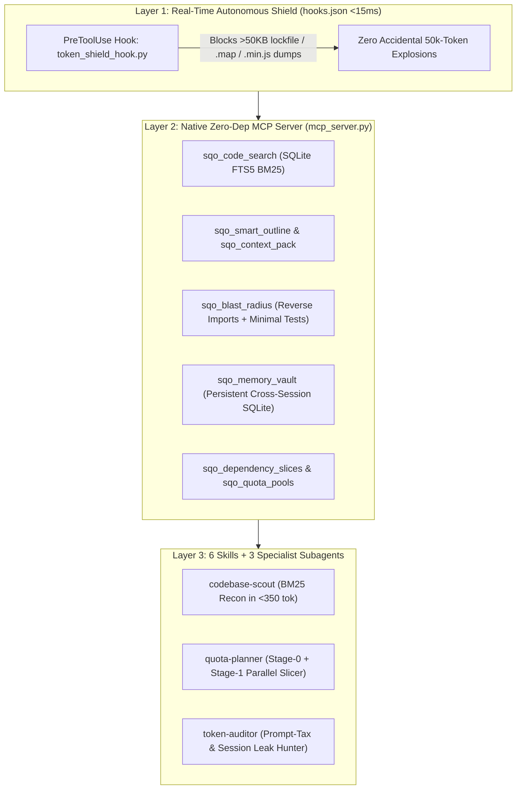

<div align="center">
  

  # Smart Quota & Swarm Orchestrator `v3.0`

  **The Autonomous AI Quota, Context-Compression & Multi-Agent Infrastructure Engine.**  
  *10 Native MCP Tools • Real-Time `PreToolUse` Token-Bomb Shield • SQLite FTS5 BM25 Search • Persistent Memory Vault • 6 Skills • 3 Subagents • 18 Zero-Dependency CLI Engines.*

  [](#quick-install)
  [](#10-native-mcp-server-tools-mcp_serverpy)
  [](#live-empirical-benchmark-sqo-benchmark)
  [-38BDF8.svg)](#19-unified-sqopy-cli-commands)
  [](LICENSE)

  Works natively across **Google Antigravity**, **Claude Code**, **Cursor**, **Windsurf**, **Codex**, **Gemini CLI**, and **`npx skills`**.

  [Quick Install](#quick-install) • [3-Layer Defense](#3-layer-autonomous-architecture) • [10 MCP Tools](#10-native-mcp-server-tools-mcp_serverpy) • [19 CLI Commands](#19-unified-sqopy-cli-commands) • [الشرح الكامل بالعربية](#-الدليل-الكامل-بالعربية-الإصدار-العملاق-v30)
</div>

---

## Live Empirical Benchmark (`python sqo.py benchmark`)

Measured deterministically on real source repositories (zero synthetic exaggeration—run `python sqo.py benchmark --workspace .` on your own repo in `<120ms`):

| Engineering Operation | Naive Agent Token Burn | `sqo v3.0` Optimized | Measured Reduction |
| :--- | :--- | :--- | :--- |
| **Codebase Feature Discovery** (`sqo search` SQLite FTS5 BM25 vs. Sequential Reads) | `~18,400` tokens | **`~420` tokens** | **97.7% saved** |
| **Large-File Structural Inspection** (`sqo outline` AST/Symbol Skeletons) | `~6,900` tokens | **`~590` tokens** | **91.4% saved** |
| **Multi-File Architecture Pack** (`sqo pack` Adaptive 3-Tier Budget) | `~18,400` tokens | **`~2,380` tokens** | **87.1% saved** |
| **120-Suite Test Runner Output** (`sqo denoise` Failure Extractor) | `~2,150` tokens | **`~95` tokens** | **95.6% saved** |

---

## 3-Layer Autonomous Architecture

Unlike passive prompt snippets, **`v3.0`** operates as **live runtime infrastructure**:



---

## Quick Install

### Option 1 — Google Antigravity Full Autonomous Bundle *(MCP + Shield Hook + 6 Skills + 3 Subagents)*

**Windows (PowerShell):**
```powershell
git clone https://github.com/ElNeMeR70/smart-quota-orchestrator.git
powershell -ExecutionPolicy Bypass -File .\smart-quota-orchestrator\install.ps1
```

**macOS / Linux:**
```bash
git clone https://github.com/ElNeMeR70/smart-quota-orchestrator.git
bash ./smart-quota-orchestrator/install.sh
```

### Option 2 — Universal Agent Skills CLI *(Claude Code, Cursor, Windsurf, Codex, Antigravity)*

```bash
# Install all 6 modular skills at once
npx skills add ElNeMeR70/smart-quota-orchestrator

# List the 6 skills in the suite
npx skills add ElNeMeR70/smart-quota-orchestrator --list
```

### Option 3 — Connect the Standalone MCP Server in Any IDE (`Cursor` / `Claude Desktop` / `Windsurf`)

Add to your `mcp_config.json` / `.cursor/mcp.json`:
```json
{
  "mcpServers": {
    "sqo-engine": {
      "command": "python",
      "args": ["/absolute/path/to/smart-quota-orchestrator/mcp_server.py"]
    }
  }
}
```

---

## 10 Native MCP Server Tools (`mcp_server.py`)

Runs on pure Python 3.8+ standard library (`0.0%` idle CPU, `<15 MB` RAM):

| MCP Tool Name | Capability |
| :--- | :--- |
| `sqo_code_search` | Instant **SQLite FTS5 BM25** symbol-chunk search returning exact `file:Lstart-Lend` matches |
| `sqo_smart_outline` | AST/Regex class & function skeletonizer + single-symbol extractor (`symbol="..."`) |
| `sqo_context_pack` | Adaptive Repomix-style context compiler (Full focus files + AST skeletons + index within `max_tokens`) |
| `sqo_blast_radius` | Transitive reverse-import analyzer returning downstream dependents + **minimal affected unit tests** |
| `sqo_memory_vault` | Persistent SQLite FTS5 cross-session architectural memory (`remember` / `recall` / `list`) |
| `sqo_dependency_slices` | Import-graph Stage-0 contract detector + collision-free parallel slice & `run_workflow` generator |
| `sqo_budgeted_diff` | Lockfile-stripping, security-prioritized semantic `git diff` compressor |
| `sqo_secret_scrub` | 10-pattern hardcoded secret scanner (masked output) & live snippet redactor |
| `sqo_quota_pools` | Shared vs. reserve model quota pool grouper, reset countdown & safe `%/hr` calculator |
| `sqo_benchmark` | Live empirical workspace token-compression benchmark runner |

---

## 6 Modular Skills & 3 Specialist Subagents

| Type | Name | Role |
| :--- | :--- | :--- |
| **Skill 1** | `smart-quota-orchestrator` | Quota pool routing, complexity scoring, cost simulation, benchmarks & HTML dashboard |
| **Skill 2** | `context-compactor` | AST outlines, adaptive multi-file packing, budgeted diffs, CLI denoiser & `<400-tok` handoffs |
| **Skill 3** | `semantic-code-navigator` | SQLite FTS5 BM25 symbol search & transitive reverse-import blast-radius test targeting |
| **Skill 4** | `project-memory-vault` | Cross-session SQLite FTS5 architectural memory vault & zero-leak secret guard |
| **Skill 5** | `parallel-slice-architect` | Multi-language import-graph partitioning & auto-`run_workflow` generator |
| **Skill 6** | `prompt-tax-profiler` | `AGENTS.md` / `CLAUDE.md` / `GEMINI.md` / `SKILL.md` per-turn static token profiler |
| **Subagent 1** | `codebase-scout` | Ultra-lean BM25 + AST recon scout returning exact `file:line` maps in `<350` tokens |
| **Subagent 2** | `quota-planner` | Stage-0 contract + Stage-1 disjoint parallel architecture planner |
| **Subagent 3** | `token-auditor` | Repo token-bomb, static rule tax & JSONL transcript leak auditor |

---

## 19 Unified `sqo.py` CLI Commands

```bash
python sqo.py doctor --workspace .                              # 6-in-1 full workspace & security health check
python sqo.py benchmark --workspace .                           # Live empirical token-savings proof table
python sqo.py search "verifyStripeWebhook jwt" --workspace .    # SQLite FTS5 BM25 code chunk search
python sqo.py pack --workspace . --max-tokens 3000              # Adaptive 3-tier multi-file context pack
python sqo.py blast-radius src/types/user.ts --workspace .      # Reverse-import impact + minimal test list
python sqo.py memory --workspace . remember -c auth -t "JWT" -d "Uses RS256 in src/auth.ts"
python sqo.py memory --workspace . recall "JWT auth"            # Instant cross-session BM25 memory recall
python sqo.py scrub --scan-workspace .                          # Zero-leak hardcoded secret audit
python sqo.py outline src/server.ts --symbol startServer        # AST skeleton or exact symbol body
python sqo.py slice --workspace . --emit-workflow               # Collision-free parallel workflow generator
python sqo.py diff --workspace . --max-tokens 1500              # Lockfile-free budgeted git diff
python sqo.py denoise --cmd "pytest"                            # Strip 90%+ passing test spam
python sqo.py prompt-tax --workspace .                          # Grade AGENTS.md / SKILL.md token tax
python sqo.py ignore-guard --workspace . --write                # Generate .agentignore / .cursorignore
python sqo.py pools --input models.json                         # Live quota pools & reset timers
python sqo.py complexity --workspace . --task "Refactor RBAC"   # Complexity (0-100) & topology router
python sqo.py simulate --files 15 --avg-loc 240 --turns 18      # Monolith vs Swarm cost simulation
python sqo.py audit --auto                                      # Active JSONL session leak detector
python sqo.py dashboard --workspace . -o quota-dashboard.html   # Standalone HTML telemetry center
```

---

<div dir="rtl">

## 🚀 الدليل الكامل بالعربية — الإصدار العملاق `v3.0`

الإصدار **`v3.0`** يحوّل المستودع من مجرد مجموعة سكربتات إلى **محرك بنية تحتية ذاتي التشغيل (Autonomous AI Agent Infrastructure)** يعمل بـ **صفر مكتبات خارجية (`100% Python Stdlib`)** ويوفر **84% إلى 97%** من التوكنز بالقياس الفعلي!

### أقوى الإضافات الثورية في `v3.0`:
1. **درع الحماية التلقائي اللحظي (`hooks.json` + `PreToolUse Shield`):**
   يعمل تلقائياً في أقل من `15ms` قبل أي أداة! لو حاول الوكيل قراءة ملفات ضخمة مولّدة مثل `package-lock.json` أو `pubspec.lock` أو ملفات `.map` و `.min.js` أو طباعتها في التيرمينال، يعترضها فوراً قبل أن تبتلع 50,000 توكن من رصيدك!
2. **سيرفر MCP مدمج بالكامل (`mcp_server.py` + `mcp_config.json`):**
   يضيف **10 أدوات MCP أصلية** مباشرة داخل Antigravity و Cursor و Claude Code و Windsurf باستهلاك معالج `0.0%` في وضع الخمول.
3. **محرك بحث الكود الذكي بـ SQLite FTS5 BM25 (`sqo search`):**
   يقسم ملفات المشروع إلى دوال وكلاسات ويرتبها بخوارزمية **BM25** المدمجة في SQLite ليعيد فقط أدق الأجزاء المطابقة بأرقام الأسطر في أقل من `250` توكن (**توفير يصل إلى 97%**).
4. **محلل دائرة التأثير واختيار الاختبارات الذكي (`sqo blast-radius`):**
   يتتبع عكسياً كل الملفات التي تستورد الملف الذي عدّلته (`Reverse Imports`) ويحدد **فقط ملفات الـ Unit Tests المتأثرة** لتشغيلها بدلاً من تشغيل مئات الاختبارات غير المرتبطة!
5. **ذاكرة المشروع المستديمة عبر الجلسات (`sqo memory`):**
   قاعدة بيانات SQLite FTS5 محلية تحفظ القرارات المعمارية وأماكن الملفات الحساسة والـ Gotchas بحيث تبدأ أي محادثة جديدة فاهمة للمشروع من أول ثانية بدون إهدار 15 خطوة استكشاف!
6. **حازم السياق التكيّفي (`sqo pack`) + فاحص التسريبات الأمنية (`sqo scrub`) + مقياس التوفير الفعلي (`sqo benchmark`).**

</div>

---

## License

Released under the [MIT License](LICENSE) by [ElNeMeR](https://github.com/ElNeMeR70).
