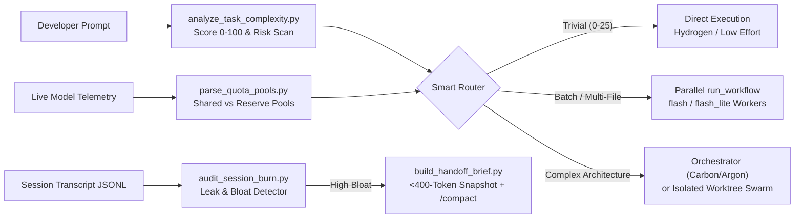

<div align="center">
  

  # Smart Quota & Swarm Orchestrator

  **Cut AI coding quota & token burn by 50–70% without sacrificing frontier intelligence.**

  [](#quick-install)
  [](LICENSE)
  [-38BDF8.svg)](#bundled-deterministic-cli-tools)
  [](#quick-install)

  Works natively as a **Google Antigravity Plugin**, **Universal `npx skills` Package**, **Claude Code Plugin**, **Cursor Skill**, and **Gemini CLI Extension**.

  [Quick Install](#quick-install) • [What It Solves](#what-it-solves) • [Bundled CLI Tools](#bundled-deterministic-cli-tools) • [الشرح بالعربية](#-الدليل-السريع-بالعربية)
</div>

---

## What It Solves

Frontier reasoning models (**Gemini 4 Carbon**, **Claude Opus 4.6**, etc.) are extraordinary architects—but running them monolithically to grep directories, read 500-line files repeatedly, fix typos, or loop on failing tests drains 5-hour/daily quotas in minutes.

**Smart Quota & Swarm Orchestrator** turns your AI coding agent into a **quota-aware engineering lead** backed by **4 deterministic, zero-dependency Python CLI scripts**:

1. **Live Quota Pool Dashboard (`parse_quota_pools.py`)** — Detects shared vs. independent model quota pools (e.g., Gemini 4 Carbon/Argon/Hydrogen/Orchestrator sharing Pool A vs. Claude 4.6 / GPT-OSS reserves in Pools B & C), calculates exact countdowns to reset, computes a safe `%/hour` burn ceiling, and recommends failover strategies.
2. **Pre-Flight Task Complexity & Parallel Router (`analyze_task_complexity.py`)** — Scans target paths & git state, flags high-risk domains (`security_auth`, `payments_billing`, `data_migration`, `concurrency_infra`), computes a **Complexity Score (`0–100`)** + **Parallelizability Index (`0.0–1.0`)**, and chooses between direct inline edits, `run_workflow` `flash` fan-outs, or isolated `workspace="share"` worktrees.
3. **Session Token-Leak Auditor (`audit_session_burn.py`)** — Audits active JSONL transcripts (Antigravity & Claude Code) to catch duplicate unchanged file reads, oversized tool outputs, and consecutive error thrashing streaks.
4. **Zero-Loss Context Compactor (`build_handoff_brief.py`)** — Generates a deterministic `<400-token` workspace & git state snapshot so `/compact`, model switches, and subagent/swarm handoffs start warm on Turn 1.

---

## Architecture



---

## Quick Install

### Option 1 — Universal Agent Skills CLI (Claude Code, Cursor, Antigravity, Codex, Windsurf)

```bash
# Install all bundled skills (smart-quota-orchestrator + context-compactor)
npx skills add ElNeMeR70/smart-quota-orchestrator

# Or list individual skills first
npx skills add ElNeMeR70/smart-quota-orchestrator --list
```

### Option 2 — Google Antigravity Full Plugin Bundle (Skills + `quota-planner` Subagent + Always-On Guardrails)

**Windows (PowerShell):**
```powershell
git clone https://github.com/ElNeMeR70/smart-quota-orchestrator.git
powershell -ExecutionPolicy Bypass -File .\smart-quota-orchestrator\install.ps1
```

**macOS / Linux:**
```bash
git clone https://github.com/ElNeMeR70/smart-quota-orchestrator.git
bash ./smart-quota-orchestrator/install.sh
```

### Option 3 — Gemini CLI / Claude Code Native Extension
Because this repository ships with `plugin.json`, `.claude-plugin/plugin.json`, and `gemini-extension.json`, it can be imported directly by Antigravity (`agy plugin install`), Claude Code, and Gemini CLI.

---

## What's Inside the Bundle

| Component | Path | Purpose |
| :--- | :--- | :--- |
| **Core Skill** | `skills/smart-quota-orchestrator/SKILL.md` | Live quota pool analysis, model/effort routing (`Low`/`Medium`/`High`/`XHigh`), & parallel fan-out workflows |
| **Compactor Skill** | `skills/context-compactor/SKILL.md` | Zero-loss `<400-token` handoff briefs before `/compact`, model switches, or swarm worker launches |
| **Planner Subagent** | `agents/quota-planner.md` | Read-only architect subagent that maps file-disjoint work slices outside your main context window |
| **Efficiency Rules** | `rules/AGENTS.md` | Lightweight guardrails preventing redundant full-file reads and blind retry loops |
| **Routing Matrix** | `skills/smart-quota-orchestrator/references/model-routing-matrix.md` | Complete comparison of Gemini 4 Carbon, Argon, Hydrogen (`XHigh`), Orchestrator, Claude 4.6, & GPT-OSS |

---

## Bundled Deterministic CLI Tools

Every script uses **100% Python 3.8+ standard library** (no `pip install` needed):

```bash
# 1. Score a task's complexity & get optimal model + parallel strategy
python skills/smart-quota-orchestrator/scripts/analyze_task_complexity.py \
  --workspace . \
  --task "Audit all API routes for JWT auth bypass and add unit tests"

# 2. Parse live Antigravity swarm(action="models", all=true) quota JSON
python skills/smart-quota-orchestrator/scripts/parse_quota_pools.py \
  --input models_telemetry.json

# 3. Audit your latest active Antigravity or Claude Code session for token leaks
python skills/smart-quota-orchestrator/scripts/audit_session_burn.py --auto

# 4. Generate a <400-token handoff brief before running /compact
python skills/context-compactor/scripts/build_handoff_brief.py \
  --workspace . \
  --goal "Finish Stripe webhook verification" \
  --next "Add signature test" "Deploy staging"
```

### Run Tests Locally

```bash
python -m unittest discover -s tests -v
```

---

<div dir="rtl">

## 🚀 الدليل السريع بالعربية

**Smart Quota & Swarm Orchestrator** هي إضافة ومهارة احترافية مفتوحة المصدر مصممة لحل أكبر مشكلة تواجه المطورين على **Google Antigravity** و **Claude Code** و **Cursor**: **استنزاف الكوتا السريع وتضخم نافذة السياق (Context Bloat)**.

### أهم المميزات العملية:
- **لوحة تحكم حية للكوتا (`parse_quota_pools.py`):** تفرّق تلقائياً بين رصيد عائلة Gemini المشترك (`Carbon`, `Argon`, `Hydrogen`, `Orchestrator`) وبين أرصدة الطوارئ المستقلة (`Claude 4.6`, `GPT-OSS`)، وتحسب الوقت المتبقي للتجديد ومعدل الاستهلاك الآمن في الساعة.
- **موجّه المهام الذكي (`analyze_task_complexity.py`):** يقيس درجة تعقيد المهمة (`0-100`) ومؤشر التوازي، ويحدد متى تستخدم `Hydrogen` السريع، أو `Orchestrator` المتوازن، أو `Carbon (High)` للمهام الأمنية والمعمارية المعقدة.
- **كاشف تسريب التوكنز (`audit_session_burn.py`):** يفحص سجل الجلسة الحالية ليكتشف الملفات التي تمت قراءتها أكثر من مرة بدون داعي أو حلقات الأخطاء المتكررة.
- **ضغط السياق بدون فقدان بيانات (`context-compactor`):** يجهز ملخصاً هندسياً دقيقاً أقل من 400 توكن لحالة المشروع والـ Git قبل استخدام أمر `/compact` أو تسليم المهمة لوكلاء فرعيين.

### أمثلة أوامر جاهزة داخل الشات بعد التثبيت:
- *"افحص حالة الكوتا الحالية ومواعيد التجديد ورشح لي أفضل نموذج أكمل بيه شغل النهاردة"*
- *"راجع استهلاك التوكنز في الجلسة دي وقولي لو محتاجين نعمل `/compact`"*
- *"حلل تعقيد المهمة دي ونفذها بأقل استهلاك كوتا ممكن"*

</div>

---

## License

Released under the [MIT License](LICENSE) by [ElNeMeR](https://github.com/ElNeMeR70).
